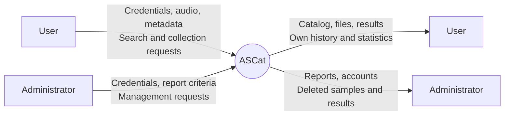
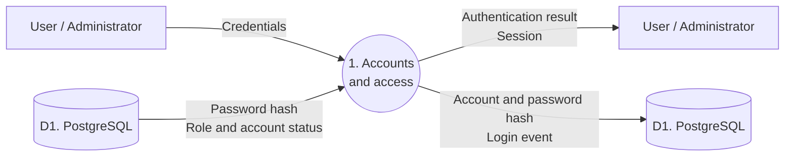
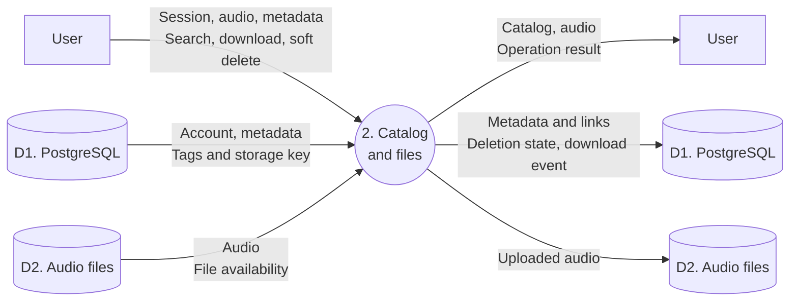
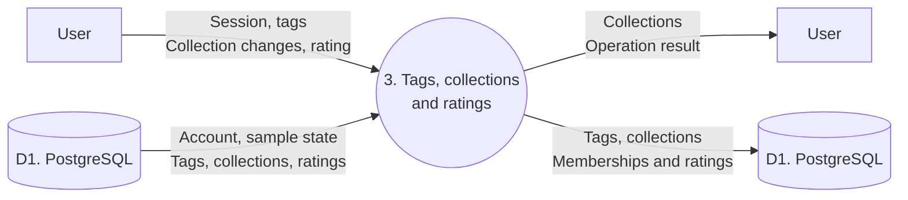
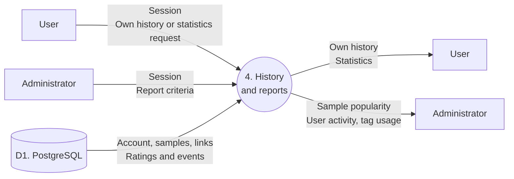
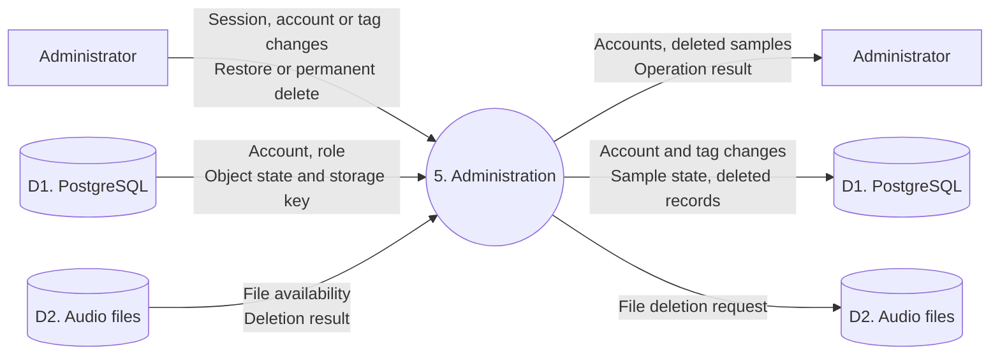

# Data Flow Diagrams

[Data model](../DATA_MODEL.md). Administrators also have regular user access.

## Context

## Processes and data stores

Each process is shown separately. Repeated actor and store nodes refer to the
same user, administrator, PostgreSQL database (D1) or audio storage (D2).
Processes validate account status, permissions and ownership before accessing data.

### 1. Accounts and access

### 2. Catalog and files

### 3. Tags, collections and ratings

### 4. History and reports

### 5. Administration

D1 contains the ERD tables, D2 stores files referenced by samples.storage_key.
