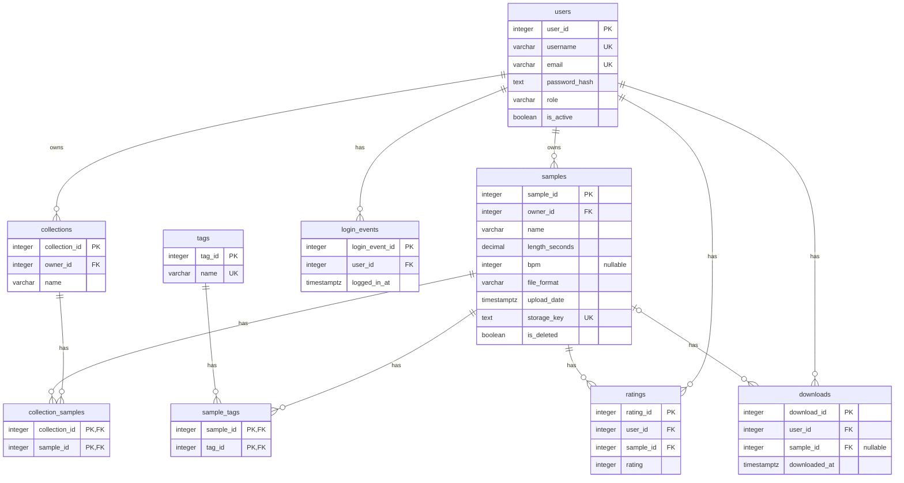

# Entity Relationship Diagram

[Data model](../DATA_MODEL.md). [DBML version](ERD.dbml) for dbdiagram.io.

Join tables have composite primary keys. Ratings has UNIQUE (user_id, sample_id).
Only samples.bpm and downloads.sample_id are nullable; downloads.sample_id
becomes NULL after permanent sample deletion.
